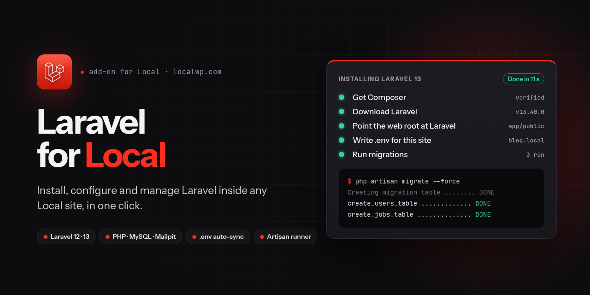
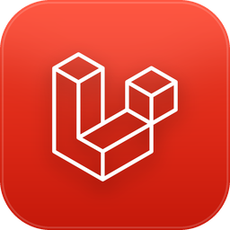

<p align="center">
  
</p>

<h1 align="center"> Laravel for Local</h1>

<p align="center">
  Install, configure and manage a <strong>Laravel</strong> app inside any <a href="https://localwp.com">Local</a> site, in one click.<br>
  It uses the site's own PHP, MySQL and Mailpit, so there is nothing else to install.
</p>

<p align="center">
  <a href="https://github.com/shahadul878/local-addon-laravel/actions/workflows/ci.yml"></a>
  <a href="LICENSE"></a>
  
  
</p>

<p align="center">
  <a href="docs/USER_GUIDE.md"><strong>User Guide</strong></a> ·
  <a href="#quick-start">Quick start</a> ·
  <a href="docs/USER_GUIDE.md#14-troubleshooting">Troubleshooting</a> ·
  <a href="CHANGELOG.md">Changelog</a>
</p>

---

## Why

Local is great for WordPress, but setting up Laravel in it by hand takes several fiddly steps:

- finding Local's PHP binary
- installing Composer
- pointing the web root at Laravel's `public/`
- discovering that Local's MySQL rejects `127.0.0.1`
- copying the ports Local assigned into `.env`, and redoing it whenever they change

This add-on does all of that and keeps it working.

## Features

- **Pre-install checks.** It checks the PHP version for the Laravel release you chose (13 → PHP 8.3+, 12 → PHP 8.2+), the required PHP extensions, whether the database is running, and what's currently in the web root.
- **One-click install** of Laravel 13 or 12 with `composer create-project`, showing live output and a step-by-step checklist. Composer is downloaded once, checksum-verified, and always runs on the **site's** PHP.
- **No server config edits.** Laravel goes into `<site>/app`, so its `public/` *is* Local's web root. It works with nginx and Apache.
- **Nothing is deleted.** The previous web root (e.g. WordPress) is moved to `app/public.backup-<time>`.
- **`.env` made for Local:**
  - `APP_URL=http://<site>.local`
  - the site's MySQL through its unix socket (or SQLite), in its own `laravel` database
  - Mailpit SMTP, so every email lands in Local's inbox
- **Stays in sync.** When Local reassigns ports or the domain changes, it fixes `.env` with one click, or automatically whenever the site starts. Only values that still point at Local are touched.
- **Artisan runner:**
  - one-click `migrate`, `migrate:status`, `db:seed`, `optimize:clear`, `route:list` and `about`
  - any command you type, run without a shell
  - a live terminal with **Copy output**
- **Clean removal.** **Remove Laravel** moves the app aside and restores the previous web root.

## Quick start

**No terminal:**
1. Download `local-addon-laravel-<version>.tgz` from the [latest release](https://github.com/shahadul878/local-addon-laravel/releases/latest).
2. In Local, go to **Add-ons → Installed → Install from disk** and pick that file.
3. Relaunch Local when it asks.

**From source** (Node.js 18+):

```bash
git clone https://github.com/shahadul878/local-addon-laravel.git
```

```bash
cd local-addon-laravel
```

```bash
npm run install-addon
```

Then (either way):

1. **Restart Local**, if you installed from source.
2. Create a site with **PHP 8.3+** and click **Start site**.
3. Open **Tools → Laravel**, choose a version and click **Install**.
4. Click **Open site**. 🎉

The full walkthrough, including the database, email, Vite, PHP versions and troubleshooting, is in the **[User Guide](docs/USER_GUIDE.md)**.

## How it works

```
~/Local Sites/blog/app/
├── app/ bootstrap/ config/ routes/ …   Laravel
├── public/                              Laravel's public/ = Local's web root
├── .env                                 written by the add-on
└── public.backup-20261107-171618/       the previous web root, untouched
```

| `.env` key | Value | Why |
| --- | --- | --- |
| `APP_URL` | `http://blog.local` | The site's Local domain |
| `DB_HOST` / `DB_SOCKET` | `localhost` + the site's `mysqld.sock` | Local's MySQL only allows `root@localhost` |
| `DB_PORT` | The port Local assigned | For tools that connect over TCP |
| `MAIL_PORT` | Mailpit's SMTP port | Mail is caught by Local's inbox |

## Updating or uninstalling

To update, pull the latest code, reinstall, and restart Local:

```bash
git pull
```

```bash
npm run install-addon
```

To uninstall the add-on, run this and restart Local. Your Laravel apps are left untouched:

```bash
npm run uninstall-addon
```

If Local keeps its data somewhere other than the default, set `LOCAL_USER_DATA`. The defaults are `~/.config/Local`, `~/Library/Application Support/Local` and `%APPDATA%\Local`.

## Development

```bash
npm install
```

```bash
npm test
```

```bash
npm run link-addon
```

`link-addon` symlinks the folder into Local, so you only need to restart Local after each change.

```
lib/
  main.js            main-process entry: wires the service, IPC and Local hooks
  laravelService.js  state, install, sync, artisan and uninstall jobs (queued one at a time per site)
  installer.js       the install steps
  preflight.js       requirement checks, shared by the main process and the UI
  envFile.js         comment-preserving .env editing
  laravelConfig.js   which .env values come from Local
  sites.js           reads Local's sites.json
  phpRuntime.js      finds Local's PHP build for a site
  project.js         web-root inspection and safe file moves
  composer.js        checksum-verified composer.phar
  processRunner.js   spawns processes without a shell, with timeouts that stop the whole process tree
  renderer.js        adds the Tools → Laravel tab
  ui/                React panel (container + presentational views)
scripts/
  install-addon.js   installs, links or removes the add-on
  make-icon.py       renders assets/icon.png
  render-preview.js  renders docs/social-preview.png from social-preview.html
```

The tests use Node's built-in runner and need no PHP, Local or network. See [CONTRIBUTING.md](CONTRIBUTING.md).

## Compatibility

| | Status |
| --- | --- |
| Linux | Tested (Local 9 and 10) |
| macOS | Should work; PHP lookup supports Intel and Apple Silicon. Not yet tested |
| Windows | Should work (TCP instead of a socket). Not yet tested |
| nginx / Apache | Both supported |
| MySQL / MariaDB / SQLite | Supported |

Reports from macOS and Windows users are very welcome. Please [open an issue](https://github.com/shahadul878/local-addon-laravel/issues).

## Credits

The add-on icon uses the official Laravel logomark from [laravel/art](https://github.com/laravel/art).

- To re-render the icon, run `python3 scripts/make-icon.py assets/icon.png` (needs Pillow and cairosvg).
- To re-render the banner from `scripts/social-preview.html`, run `node scripts/render-preview.js` (needs Chrome).

Laravel and the Laravel logo are trademarks of Laravel Holdings Inc. Local is a product of WP Engine. This is an independent project, not affiliated with or endorsed by either.

## License

[MIT](LICENSE) © 2026 Shahadul
